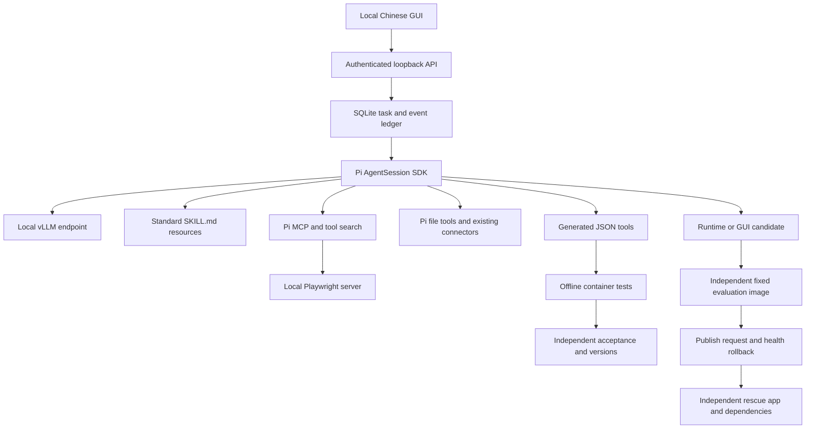

# Architecture

## Responsibilities

- `domain.ts`: task, capability, memory, Skill and configuration contracts.
- `store.ts`: synchronous SQLite persistence and append-only events.
- `engine.ts`: serial durable task queue and outcome validation; delegates agent execution to Pi.
- `pi.ts`: explicitly configured local model runtime, Pi sessions, compaction, standard resources, native MCP, clean shutdown.
- `tools.ts`: application tool adapters, action evidence, idempotent write intent and scoped I/O. read/write/edit call Pi's implementations rather than reimplementing editing algorithms.
- `registry.ts`: versioned generated tools, schema validation, self-tests versus independent acceptance, activation and rollback.
- `sandbox.ts` / `process.ts`: bounded child processes, offline container execution and independent evaluator invocation.
- `changes.ts`: candidate source overlay, fixed evaluator, artifact hash checks, release requests. Successive patches retain the active source overlay.
- `policy.ts` / `network.ts`: allowed paths, model endpoints, resource settings and pinned-DNS public text retrieval.
- `calendar.ts` / `vault.ts`: readonly iCloud connector and authenticated encrypted local credentials.
- `runtime/`: writable strategy modules. Currently context selection; new policy helpers can be added as part of a candidate.
- `app.ts` / `main.ts`: HTTP transport and local lifecycle.
- `web/`: GUI; receives persisted actual states and events.
- `scripts/supervisor.mjs`: independent restart, release switch, artifact integrity check, last-good/rescue fallback. Owns the release pointer; app does not directly switch itself.

## Task and tool outcomes

A successful tool result proves that call executed and its result was recorded. It does not prove every semantic aspect of an arbitrary user goal. `task_finish` distinguishes an answer from an action, and action outcomes require evidence belonging to that task. Development and repair tasks must create an actual tool or application candidate.

A generated tool with only model-written examples stays `tested`, not `active`. Independent cases are supplied before development or later by the owner. These cases are withheld from the model's tool responses, though the local owner can inspect all records. Failed replacements leave the previous active version available.

Writes are journaled before execution. A completed identical write can reuse its recorded outcome. A crash between write intent and completion blocks blind replay; it does not magically guarantee exactly-once execution across arbitrary external systems.

## Self repair and recovery

Generated tool failures enqueue a bounded repair task using the same independent cases. App candidates are evaluated with checks and tests from the original evaluator image, not files replaced by the candidate. Only runtime strategy and GUI source paths are eligible. Published artifacts include hashes and source overlays. The supervisor waits for no running tasks, validates artifacts, switches the app, and falls back after repeated failures. A fallback candidate creates a durable repair request for the restored app.

The evaluation image must be rebuilt after a trusted base application update. Regression success is necessary evidence, not proof of all behavior or security. Published Node code has the launching user's host permissions. Default manual publication is intentional; owners can opt into automatic publication after evaluation. No component can guarantee recovery from a broken GPU driver, OS, disk or independently damaged supervisor.

## Data

Installer layout:

- `%LOCALAPPDATA%/Alien/app`: versioned application source and dependencies.
- `%LOCALAPPDATA%/Alien/data`: SQLite, Pi sessions, access token, vault, user workspace, candidates and backups.
- `%LOCALAPPDATA%/Alien/runtime`: portable Node.
- `app/.releases`: evaluated app artifacts plus independent rescue dependencies.
- WSL `~/.local/share/alien/inference`: vLLM Python environment.

The GitHub repository and Windows ZIP contain source, tests, instructions and open-source Skill files only. They exclude data, credentials, dependency caches, browser profiles and model weights.

## Existing components

Use the complete Pi SDK as the single agent harness. Do not stack Hermes, OpenClaw and Pi agent loops inside the same task. Use existing MCP/CLI integrations for supported capabilities; add application-specific adapters only where they enforce a real permission, evidence or lifecycle boundary. See `reuse.md` for the researched candidates, including unintegrated optional packages.
